# PSOC&trade; Edge HMI Kit: Smart thermostat

This code example demonstrates a smart thermostat panel user interface, designed to mimic the features of a real thermostat. You can simulate monitoring and controlling the temperature through the touchscreen, through voice commands, or remotely using a mobile application. The system also incorporates radar-based presence detection to mimic automatic adjustments to operation modes and power states based on user activity.

The thermostat application runs on the PSOC&trade; Edge E84 HMI Kit, equipped with a PSOC&trade; Edge E84 dual-core microcontroller featuring machine learning capabilities. The kit includes a 4-inch MIPI-DSI capacitive touch display, delivering a responsive and intuitive user interface, sensors such as XENSIV&trade; digital and analog microphones, XENSIV&trade; 60 GHz radar, a 6-axis motion sensor, and environmental sensors for monitoring humidity and temperature. Additionally, the kit features an AIROC&trade; Wi-Fi and Bluetooth&reg; connectivity radio and Octal-SPI flash and RAM memory devices. These components work seamlessly to highlight the advanced functionality of the thermostat application while showcasing the capabilities of the PSOC&trade; Edge platform.

The GUI is powered by LVGL and developed using SquareLine Studio UI editor.

[View this README on GitHub.](https://github.com/Infineon/mtb-example-psoc-edge-hmi-thermostat)

See [Design and implementation](docs/design_and_implementation.md) for detailed information on the features and functional description of this code example.


## Requirements

- [ModusToolbox&trade;](https://www.infineon.com/modustoolbox) v3.8 or later (tested with v3.8)
- Board support package (BSP) minimum required version: 1.0.0
- Programming language: C
- Associated parts: All [PSOC&trade; Edge MCU](https://www.infineon.com/products/microcontroller/32-bit-psoc-arm-cortex/32-bit-psoc-edge-arm) parts


## Supported toolchains (make variable 'TOOLCHAIN')

- Arm&reg; Compiler v6.22 (`ARM`)
- LLVM Embedded Toolchain for Arm&reg; v19.1.5 (`LLVM_ARM`)

## Supported kits (make variable 'TARGET')

- `KIT_PSE84_HMI` - Default value of `TARGET` <br>


## Hardware setup

This example uses the board's default configuration. See the kit user guide to ensure that the board is configured correctly.

Ensure the following jumper and pin configuration on the board:
- The BOOT SW must be in the HIGH/ON position

   **Figure 1.  Boot switch position**

   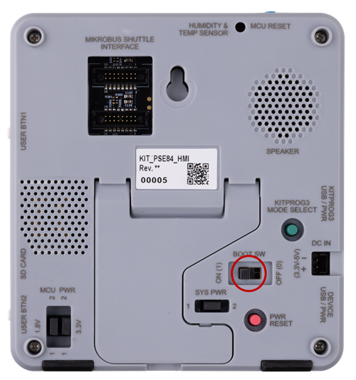

## Software setup

See the [ModusToolbox&trade; tools package installation guide](https://www.infineon.com/ModusToolboxInstallguide) for information about installing and configuring the tools package.

Install a terminal emulator if you do not have one. Instructions in this document use [Tera Term](https://teratermproject.github.io/index-en.html).

> **Note**:
>   * This example is accompanied by a mobile app to enable control of the thermostat application remotely over Bluetooth&reg; or Wi-Fi
>   * Install and use the latest Android [mobile app](https://play.google.com/store/apps/details?id=com.infineon.psochmikit)
>   * Install and use the latest iOS [mobile app](https://apps.apple.com/in/app/psoc-edge-e84-hmi-kit/id6758713080)


## Operation

See [Using the code example](docs/using_the_code_example.md) for instructions on creating a project, opening it in various supported IDEs, and performing tasks, such as building, programming, and debugging the application within the respective IDEs.

1. Connect the kit to a PC or power source using a type-C USB cable via the KitProg3 USB connector
2. The thermostat starts with a boot-up screen that displays the Infineon logo, followed by the thermostat user interface
3. Use the touch screen on the kit to set your target temperature or adjust the fan speed or mode. The thermostat simulates operation by showing changes in temperature and fan speed

   **Figure 2. Changing the temperature set-point, mode, and fan speed**

   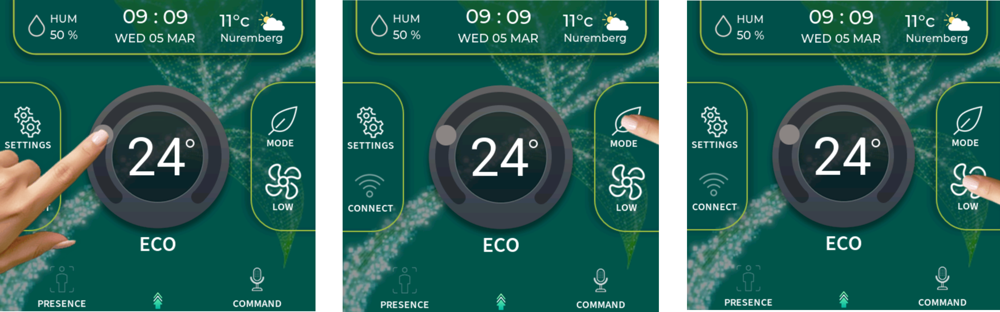
   
4. Speak the phrase "Okay thermostat" to trigger the voice assistant, then provide voice commands such as "Go to Settings" or "Reduce temperature by {one/two/.../ten} degrees". The thermostat adjusts its settings based on the given commands

   **Figure 3. Say "Okay thermostat" followed by "Go to Settings" voice command**

   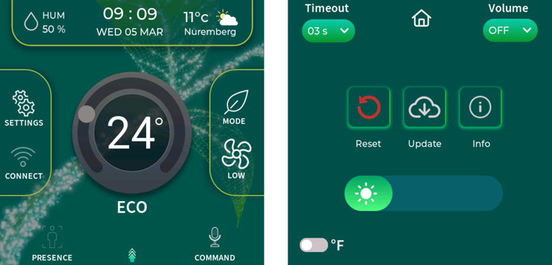

   > **Note:** The audio-voice-core library and VA inferencing library included in this example provide limited operation of approximately 15 minutes and 30 minutes, respectively. For an unlimited license, contact Infineon support. See [Using the code example](docs/using_the_code_example.md) or *note.md* in *proj_cm55\source\audio\modules\audio_voice_core_lib* for instructions on placing the licensed version of libraries within the code folder structure.

5. The kit uses a radar sensor to detect human presence. Move away from the kit (beyond 1 meter), to observe the kit automatically enter idle mode by dimming the screen. Approach the kit again to observe the display transition back to the active state

   **Figure 4. Switching between idle and active screen using radar-based presence detection**

   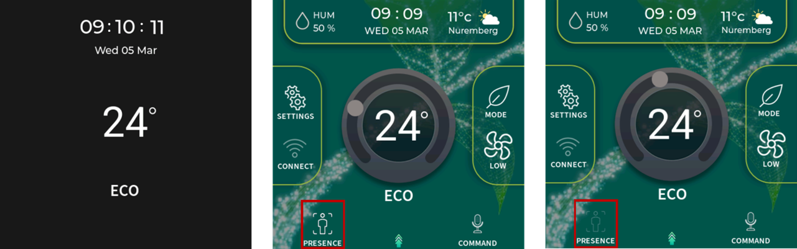
   
6. Follow the steps below (**Step 6** to **Step 10**) to control the thermostat application remotely. Tap the **CONNECT** icon as shown. Tap the mobile icon to start Bluetooth&reg; advertisements. Open the mobile app and follow the instructions to pair your device with the thermostat via Bluetooth&reg;

   **Figure 5. Bluetooth&reg; pairing with thermostat using the mobile app**

   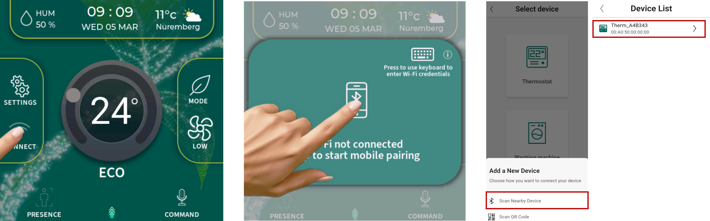
   
7. Once paired, the mobile app indicates an active connection with the thermostat over Bluetooth&reg;. Tap the thermostat icon on the home screen to navigate to the thermostat control screen. From there, you can adjust the temperature, fan speed, modes, and configure the date and time directly from your smartphone

   **Figure 6. Controlling thermostat over Bluetooth&reg; using the mobile app**

   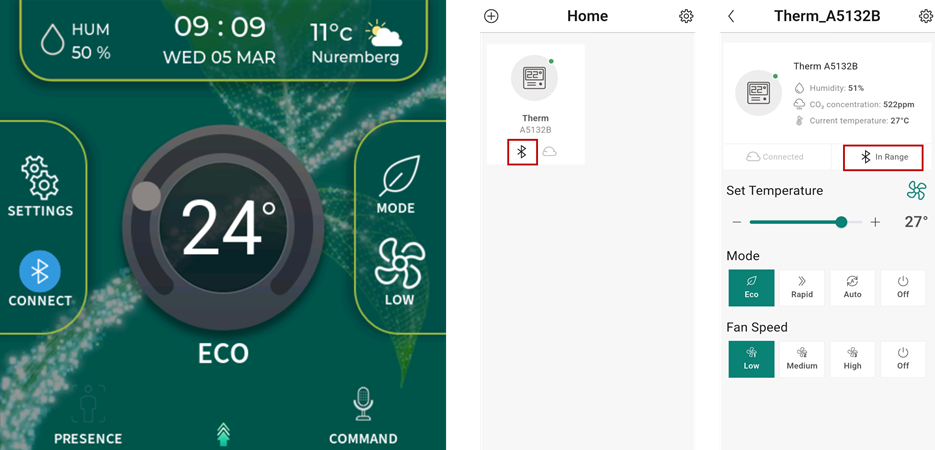
   
8. On the PSOC&trade; Edge HMI Kit, tap the Wi-Fi icon, and enter your Wi-Fi SSID and password using the on-screen keyboard. The thermostat will then connect to your Wi-Fi network

   **Figure 7. Wi-Fi onboarding on the thermostat using the keyboard**

   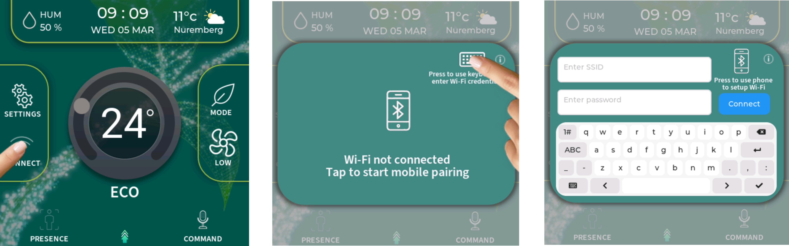
   
9. Alternatively, you can configure the Wi-Fi credentials through the mobile app (MAPP). Open the application, navigate to **SETTINGS** → **Configure Wi-Fi credentials**, and select your Wi-Fi network

   **Figure 8. Wi-Fi onboarding on thermostat via the mobile app**

   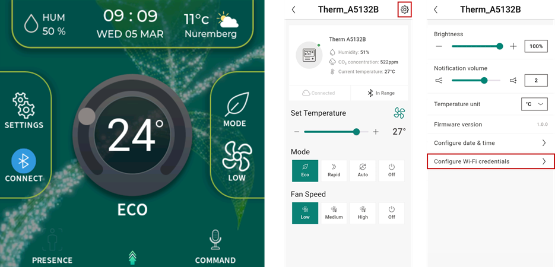
   
10. After connecting to the Wi-Fi, the thermostat connects to the AWS cloud platform using an MQTT client. This connection enables cloud-based remote control and monitoring of the thermostat via mobile app. To enable cloud control functionality, please see [AWS Cloud Configuration](#aws-cloud-configuration)

    **Figure 9. Controlling the thermostat over the cloud using the mobile app**

    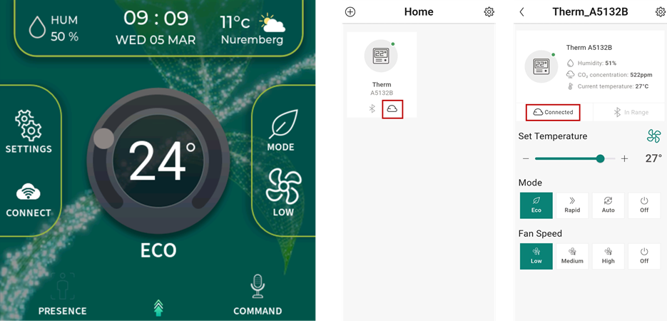

11. After connecting to the Wi-Fi, the thermostat fetches its approximate location from an IP-based location service over HTTP and displays it on the thermostat screen. The outdoor weather icon and temperature show default values. To display live weather, set `WEATHER_SERVER_HOST` and `WEATHER_PATH_FORMAT` to a weather service of your choice in *proj_cm33_ns/source/connectivity_manager/http/secure_http_client.h* and adapt the response parser in *secure_http_client.c*.


    **Figure 10. Sync the thermostat with the current location**

    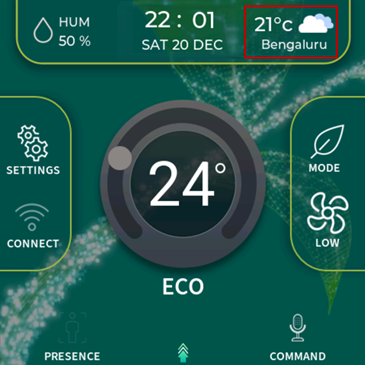
    
12. The current time and date received from the connected mobile app over Bluetooth&reg; is updated in the RTC, ensuring that the system maintains the accurate time and date, even during power loss. To ensure RTC functionality, a coin cell battery should be installed in the HMI kit
13. The thermostat functionality also includes the ability to display the changes in humidity of the current environment. Observe how the humidity percentage(%) dynamically updates in real time
14. Access the **SETTINGS** menu on the thermostat to customize its features and behavior. You can adjust preferences, such as display brightness, screen timeout values, and advanced settings

    **Figure 11. Setting screen**

    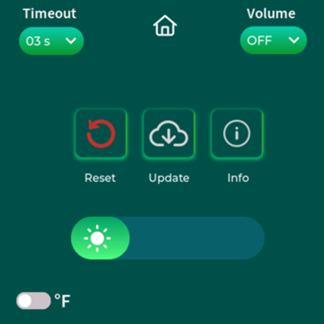

15. To explore more out-of-box (oob) steps, see the PSOC&trade; Edge E84 HMI Kit guide


### AWS Cloud Configuration

<details><summary><b>MQTT Configurations</b></summary> Configure the MQTT client credentials in `mqtt_client_config.h` file with the following essential parameters:

- `MQTT_BROKER_ADDRESS`: Hostname of the MQTT broker
- `MQTT_PORT`:  Port number to use for the MQTT connection. As specified by Internet Assigned Numbers Authority (IANA), port numbers assigned to the MQTT protocol are '1883' for non-secure connections and '8883' for secure connections. However, MQTT brokers may use other ports. Configure this macro as specified by the MQTT broker
- `MQTT_SECURE_CONNECTION`: Set this macro as '1' if you need to establish a secure (transport layer security (TLS)) connection to the MQTT broker
- `MQTT_USERNAME` and `MQTT_PASSWORD`: User name and password for client authentication and authorization if required by the MQTT broker. Note that this information is generally not encrypted and the password is sent in plain text. Therefore, this is not a recommended method of client authentication
- `CLIENT_CERTIFICATE` and `CLIENT_PRIVATE_KEY`: Certificate and private key of the MQTT client used for client authentication
- `ROOT_CA_CERTIFICATE`: Root CA certificate of the MQTT broker

</details>

<details><summary><b>Setting up the MQTT broker</b></summary>

   1. Set up the MQTT device (also known as a **Thing**) in the AWS IoT core as described in the [Getting started with AWS IoT tutorial](https://docs.aws.amazon.com/iot/latest/developerguide/iot-gs.html)

         > **Note:** While setting up your device, ensure that the policy associated with this device permits all MQTT operations (iot:Connect, iot:Publish, iot:Receive, and iot:Subscribe) for the resource used by this device. For testing purposes, it is recommended to have the following policy document, which allows all MQTT Policy Actions on all Amazon Resource Names (ARNs)

         ```
         {
            "Version": "2012-10-17",
            "Statement": [
                  {
                     "Effect": "Allow",
                     "Action": "iot:*",
                     "Resource": "*".                  
                  }
            ]
         }
         ```

   2. In the *mqtt_client_config.h* file, set `MQTT_BROKER_ADDRESS` to your custom endpoint on the **Settings** page of the AWS IoT console. This has the 'ABCDEFG1234567.iot.<region>.amazonaws.com' format

   3. Set the macros `MQTT_PORT` to '8883' and `MQTT_SECURE_CONNECTION` to '1' in the *mqtt_client_config.h* file

   4. Download the following certificates and keys that are created and activated in the previous step:

         - A certificate for the AWS IoT Thing: *xxxxxxxxxx.cert.pem*
         - A public key: *xxxxxxxxxx.public.key*
         - A private key: *xxxxxxxxxx.private.key*
         - Root CA "RSA 2048 bit key: Amazon Root CA 1" for AWS IoT from [CA certificates for server authentication](https://docs.aws.amazon.com/iot/latest/developerguide/server-authentication.html#server-authentication-certs)

   5. Using these certificates and keys, enter the following parameters in *mqtt_client_config.h* in the privacy-enhanced mail (PEM) format:
         - `CLIENT_CERTIFICATE`: *xxxxxxxxxx.cert.pem*
         - `CLIENT_PRIVATE_KEY`: *xxxxxxxxxx.private.key*
         - `ROOT_CA_CERTIFICATE`: Root CA certificate

      Either convert the values to strings manually following the format shown in *mqtt_client_config.h* or use the HTML utility available [here](https://github.com/Infineon/amazon-freertos/blob/master/tools/certificate_configuration/PEMfileToCString.html) to convert the certificates and keys from the PEM to C string format. Clone the repository from GitHub to use the utility

</details>

## Related resources

Resources  | Links
-----------|----------------------------------
Application notes  | [AN235935](https://www.infineon.com/AN235935) – Getting started with PSOC&trade; Edge E84 MCU on ModusToolbox&trade; software <br> [AN237939](https://www.infineon.com/AN237939) – Developing high-performance graphics with low-power optimization on PSOC&trade; Edge MCU
Code examples  | [Using ModusToolbox&trade;](https://github.com/Infineon/Code-Examples-for-ModusToolbox-Software) on GitHub
Device documentation | [PSOC&trade; Edge E84 MCU datasheet](https://www.infineon.com/products/microcontroller/32-bit-psoc-arm-cortex/32-bit-psoc-edge-arm/psoc-edge-e84#Documents) <br> [PSOC&trade; Edge E84 MCU reference manuals](https://www.infineon.com/products/microcontroller/32-bit-psoc-arm-cortex/32-bit-psoc-edge-arm/psoc-edge-e84#Documents)
Development kits | Select your kits from the [Evaluation board finder](https://www.infineon.com/cms/en/design-support/finder-selection-tools/product-finder/evaluation-board)
Libraries  | [mtb-dsl-pse8xxgp](https://github.com/Infineon/mtb-dsl-pse8xxgp) – Device support library for PSE8XXGP <br> [retarget-io](https://github.com/Infineon/retarget-io) – Utility library to retarget STDIO messages to a UART port <br> [serial-memory](https://github.com/Infineon/serial-memory) - Serial Flash Middleware for External memory interface <br> [DFU](https://github.com/Infineon/dfu) – Device Firmware Update Middleware (DFU MW) <br> [emusb-device](https://github.com/Infineon/emusb-device) – USB Device stack for embedded applications
Tools  | [ModusToolbox&trade;](https://www.infineon.com/modustoolbox) – ModusToolbox&trade; software is a collection of easy-to-use libraries and tools enabling rapid development with Infineon MCUs for applications ranging from wireless and cloud-connected systems, edge AI/ML, embedded sense and control, to wired USB connectivity using PSOC&trade; Industrial/IoT MCUs, AIROC&trade; Wi-Fi and Bluetooth&reg; connectivity devices, XMC&trade; Industrial MCUs, and EZ-USB&trade;/EZ-PD&trade; wired connectivity controllers. ModusToolbox&trade; incorporates a comprehensive set of BSPs, HAL, libraries, configuration tools, and provides support for industry-standard IDEs to fast-track your embedded application development

<br>


## Other resources

Infineon provides a wealth of data at [www.infineon.com](https://www.infineon.com) to help you select the right device, and quickly and effectively integrate it into your design.


## Document history

Document title: *CE242776* - *PSOC&trade; Edge HMI Kit: Smart thermostat*

 Version | Description of change
 ------- | ---------------------
 1.0.0   | New code example
 1.0.1   | Updated the design file to use the latest SPI personality
 1.1.0   | Added LLVM toolchain support, upgraded LVGL to v9.5.0 and enhanced overall performance
<br>


All referenced product or service names and trademarks are the property of their respective owners.

The Bluetooth&reg; word mark and logos are registered trademarks owned by Bluetooth SIG, Inc., and any use of such marks by Infineon is under license.

PSOC&trade;, formerly known as PSoC&trade;, is a trademark of Infineon Technologies. Any references to PSoC&trade; in this document or others shall be deemed to refer to PSOC&trade;.

---------------------------------------------------------

(c) 2026, Infineon Technologies AG, or an affiliate of Infineon Technologies AG. All rights reserved.
This software, associated documentation and materials ("Software") is owned by Infineon Technologies AG or one of its affiliates ("Infineon") and is protected by and subject to worldwide patent protection, worldwide copyright laws, and international treaty provisions. Therefore, you may use this Software only as provided in the license agreement accompanying the software package from which you obtained this Software. If no license agreement applies, then any use, reproduction, modification, translation, or compilation of this Software is prohibited without the express written permission of Infineon.
<br>
Disclaimer: UNLESS OTHERWISE EXPRESSLY AGREED WITH INFINEON, THIS SOFTWARE IS PROVIDED AS-IS, WITH NO WARRANTY OF ANY KIND, EXPRESS OR IMPLIED, INCLUDING, BUT NOT LIMITED TO, ALL WARRANTIES OF NON-INFRINGEMENT OF THIRD-PARTY RIGHTS AND IMPLIED WARRANTIES SUCH AS WARRANTIES OF FITNESS FOR A SPECIFIC USE/PURPOSE OR MERCHANTABILITY. Infineon reserves the right to make changes to the Software without notice. You are responsible for properly designing, programming, and testing the functionality and safety of your intended application of the Software, as well as complying with any legal requirements related to its use. Infineon does not guarantee that the Software will be free from intrusion, data theft or loss, or other breaches (“Security Breaches”), and Infineon shall have no liability arising out of any Security Breaches. Unless otherwise explicitly approved by Infineon, the Software may not be used in any application where a failure of the Product or any consequences of the use thereof can reasonably be expected to result in personal injury.
