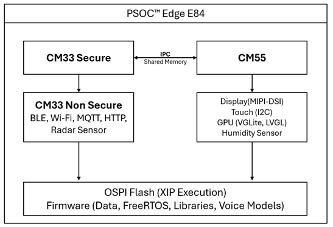
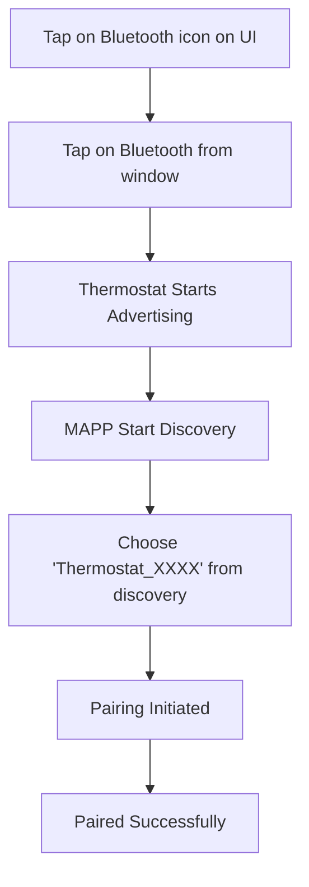
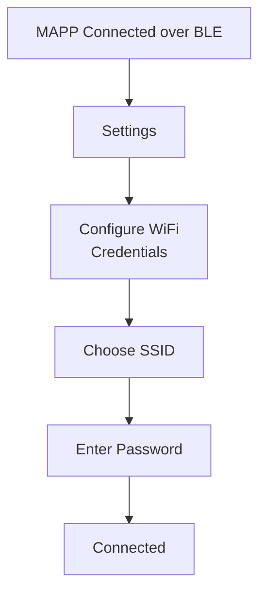
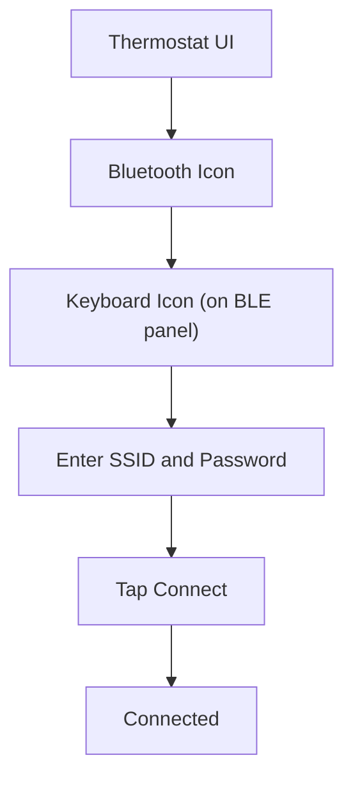
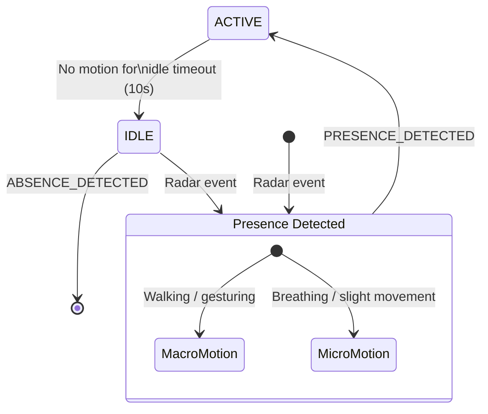

[Click here](../README.md) to view the README.

## Design and implementation

The PSOC&trade; Edge E84 Smart Thermostat HMI is a multi-core embedded system that combines graphics rendering, wireless connectivity, voice control, and presence detection to create an intelligent Thermostat application. The system leverages a heterogeneous tri-core architecture:
<br>

### <b>Architecture overview</b>

#### **System block diagram**



---

**Expand the following sections to view more details:**

---

<details><summary><b>Boot flow and CPU partioning</b></summary>

The boot process involves initializing an extended MCU boot loader, setting up the CM33 Secure core for critical tasks like TrustZone and crypto, and launching the CM33 Non-Secure core for FreeRTOS task creation. Finally, the CM55 core is powered on to initialize the GUI with LVGL and IPC endpoints.

#### **Core responsibilities**


| Core                | Primary functions                                                                                                         |
| --------------------- | --------------------------------------------------------------------------------------------------------------------------- |
| **CM33 Secure**     | Boot chain, TrustZone MPU/PPC setup, secure storage, crypto contexts                                                      |
| **CM33 Non-Secure** | Wi-Fi/Bluetooth&reg; LE connectivity, MQTT cloud integration, HTTP weather fetch, radar-based presence detection, IPC |
| **CM55**            | Graphics display and touch interface, LVGL UI rendering, voice wake-word + command detection, SHT40 temperature and humidity sensor, speaker interface, LED, IPC |

##### **CM33 Secure core**

The proj_cm33_s firmware manages the TrustZone protection, secure memory management, and boot sequencing for the system. It ensures that the critical operations are isolated and securely initialized. The key responsibilities include:

- **TrustZone protection**: Configures memory regions to enforce trusted and non-trusted access via TrustZone technology, ensuring secure isolation for critical operations
- **Memory management**: Allocates secure memory regions for cryptographic functions, firmware integrity validation, and secure inter-core communication
- **Boot sequencing**: Coordinates the secure boot process, verifying the non-secure firmware for CM33-NS and CM55 cores and ensuring the firmware integrity before execution

This secure core provides a foundation for the system’s overall reliability, enhancing protection against unauthorized access and tampering.

---

##### **CM33 Non-Secure core**

The proj_cm33_ns firmware manages all communication protocols (Wi-Fi, Bluetooth&reg; LE, MQTT, HTTP), radar-based presence detection, and backend processing for the system. It handles inter-core communications with the CM55 core and plays a critical role in enabling network connectivity and backend services. The key responsibilities include:

- **Initialization of board support package (BSP)**:
  Sets up hardware peripherals, including timers for low-power idle modes and IPC for inter-core communication
- **Wi-Fi, Bluetooth&reg; LE, and network management**: Handles tasks for Wi-Fi connection, Bluetooth&reg; LE pairing, and HTTP/MQTT protocols through the H1 WiFi-BT Combo Module (CYW555IUBGT)

  - Connects to AWS IoT Core via MQTT for cloud integration
  - Fetches weather and timezone data via HTTP client over Wi-Fi
- **Radar-based presence detection**: Initializes and reads sensor data:

  - **XENSIV&trade; BGT60TR13C radar sensor (SPI)** for detecting presence and motion data (macro-motion and micro-motion).
    Presence detection results are transmitted to the CM55 core using IPC for UI updates
- **FreeRTOS task management**:
  Schedules tasks for efficient handling of network operations (Wi-Fi, Bluetooth&reg; LE, MQTT, HTTP), ensuring smooth execution
- **IPC communication**:
  Sends processed sensor data, connection status, and network-related events to the CM55 core for UI updates

---

##### **CM55 core**

The proj_cm55 firmware is responsible for the display interface and touch input processing, graphical rendering,  and voice control. It uses the LVGL graphics library to render a dynamic and responsive graphical user interface (GUI) for the thermostat. The key responsibilities include:

- **Device peripheral initialization**:

  - Initializes the 4-inch MIPI-DSI touch display with a resolution of 480×480 pixels
  - Configures the touch drivers via I2C interface to support display interactions
  - Sets up the PDM microphones to capture audio input

- **Sensor reading**:

  - Reads the Sensirion SHT40 sensor (I2C) for real-time temperature and humidity measurement
  - Sensor readings are used to update the UI directly on the CM55 core

- **Graphics and UI management**:

  - Sets up and initializes the LVGL graphics engine to deliver fast and efficient rendering performance
  - Dynamically generates and displays a wide range of UI elements, including: sliders, fan speed, temperature indicators, and presence detection icons
  - Ensures seamless updates to UI components in real-time, reflecting changes in sensor data and user interactions

- **Voice assistance integration**:

  - Processes input from the PDM microphones
  - Waits for the wake word "OK Thermostat" followed by user command for actions, such as changing thermostat modes or temperature adjustment

- **Touch input processing**:
  Captures user input from the capacitive touch interface and maps it to thermostat features (e.g., adjusting temperature, fan speed)

- **Environmental display updates**:
  Receives sensor and presence detection data via IPC from the CM33 core and updates the UI accordingly

#### **IPC communication**

**Endpoint 1 (CM33 → CM55):** Device events (Wi-Fi connected, MQTT status, sensor data updates)<br>
**Endpoint 2 (CM55 → CM33):** User commands (temperature setpoint, mode change, voice actions)

</details>

<br>

<details><summary><b>Graphics and UI (LVGL)</b></summary>

The touch display subsystem leverages the Light and Versatile Graphics Library (LVGL) v9.1.0 running on the CM55 core, with GPU acceleration provided by VG-Lite for seamless DSI-based rendering.

The thermostat's screen provides an intuitive interface to interact with various features and monitor environmental conditions. It serves as the primary way for users to control room parameters, adjust settings, and receive real-time updates.

#### **Display hardware**

- **Primary:** ST7701S MIPI DSI LCD controller (480×480 default)
- **Touch:** FT5446 capacitive controller via I2C (400 kHz)
- **Interface:** DPI-24 bit, 2 DSI Lane and 500 Mbps per Lane
- **Frame Rate:** 40 FPS target

>**Note:** Display horizontal resolution width is 512 to achieve 128 byte stride alignment per display controller requirements

```c
#define MY_DISP_VER_RES                              (480U)
#define MY_DISP_HOR_RES                              (512U)
```

#### **LVGL configuration**

**Key settings in `proj_cm55/source/display/lvgl/lv_conf.h`:**

```c
#define LV_COLOR_DEPTH          16    // RGB565 to optimize performance with XIP
#define LV_DEF_REFR_PERIOD      25    // Target 40 frame refresh per second
```

#### **Touch event handling**

The touch interaction on the thermostat is managed using the FT5446 capacitive touch controller, with implementation details in the file:

**File:** `proj_cm55/source/display/drivers/touch-ctp-ft5446/mtb_ctp_ft5446.c`

```c
cy_rslt_t mtb_ctp_ft5446_get_single_touch ( int *touch_x, int *touch_y )
{
    cy_rslt_t result = CY_RSLT_SUCCESS;
    static uint16_t last_touch_x = RESET_VAL;
    static uint16_t last_touch_y = RESET_VAL;
    uint16_t current_touch_x = RESET_VAL;
    uint16_t current_touch_y = RESET_VAL;
    uint32_t touch_data = { (uint8_t)RESET_VAL };

    CY_ASSERT(NULL != touch_x);
    CY_ASSERT(NULL != touch_y);

    result = (cy_rslt_t) mtb_ctp_ft5446_read_raw_touch_data(&touch_data);

    if ( CY_RSLT_SUCCESS == result )
    {
        current_touch_x = (touch_data & 0x0FFF0000) >> 16;
        current_touch_y = touch_data & 0x00000FFF;

        /* To check the last touch position is equal to the current touch position */
        if ( (last_touch_x != current_touch_x) || (last_touch_y != current_touch_y) )
        {
            *touch_x = (int)((current_touch_x * MTB_CTP_TOUCH_RESOLUTION_X) / TP_MAX_VAL_X);
            *touch_y = (int)((current_touch_y * MTB_CTP_TOUCH_RESOLUTION_Y) / TP_MAX_VAL_Y);
            last_touch_x = current_touch_x;
            last_touch_y = current_touch_y;
        }
        else
        {
            result = (cy_rslt_t) CY_RSLT_FT5446_NO_TOUCH;
        }
    }

    return result;
}
```

</details>

<br>

<details><summary><b>Connectivity</b></summary>

#### **Bluetooth&reg; Low Energy**

The Bluetooth&reg; Low Energy (LE) implementation for the thermostat uses **btstack** to enable device discovery, pairing, and communication with the mobile application over GATT services. Below are the details of the pairing flow and implementation.



#### **Wi-Fi**

With Wi-Fi connectivity, the thermostat can seamlessly access the internet, leveraging cloud services to retrieve real-time data using HTTP and MQTT services.

- HTTP client: Used for dynamically retrieving weather and timezone information
- MQTT client: Enables integration with AWS IoT core for cloud-based control and communication

#### **Wi-Fi onboarding through MAPP**

The thermostat can be provisioned with Wi-Fi credentials using the MAPP (mobile app) via a Bluetooth&reg; LE connection. The steps for Wi-Fi onboarding through the mobile app are as follows:



The mobile app securely transfers the Wi-Fi SSID and password to the thermostat, which then connects to the specified network and establishes cloud connectivity.

#### **WiFi onboarding through UI**

Users can also set up Wi-Fi credentials directly through the thermostat's UI.



</details>

<br>

<details><summary><b>Voice control</b></summary>

#### **Overview**

The voice assistant system integrates DEEPCRAFT&trade; AI technology to provide natural voice control for thermostat operations. The voice assistant combines wake-word detection with command recognition capabilities, enabling hands-free interaction through far-field voice capture and real-time audio enhancement processing. All audio processing runs locally on the CM55 core - no cloud connectivity is required, eliminating latency and ensuring privacy.

The voice assistant operates through an event-driven architecture supporting the Wake word + single command mode (`VA_MODE_WW_SINGLE_CMD`), where users say "OK Thermostat" followed by a voice command. The system processes one command per wake-word activation and returns to standby mode, requiring the wake word for each new command.

#### **Voice models and training**

The DEEPCRAFT&trade; voice assistant models used in the application are trained specifically for thermostat-related commands. These model files are located under the CM55 source folder and contain trained configurations for wake-word detection and command recognition.

**Models location:** `proj_cm55/source/audio/voice_assistant/va_models/VA_HMI_Thermostat_Demo/`

```
proj_cm55/source/audio/voice_assistant/
├── va_models
│   └── VA_HMI_Thermostat_Demo
│       ├── VA_HMI_Thermostat_Demo.h
│       ├── VA_HMI_Thermostat_Demo.json
│       ├── VA_HMI_Thermostat_Demo_U55_CMDmodel.c
│       ├── VA_HMI_Thermostat_Demo_U55_CMDmodel.h
│       ├── VA_HMI_Thermostat_Demo_U55_WWmodel.c
│       ├── VA_HMI_Thermostat_Demo_U55_WWmodel.h
│       ├── VA_HMI_Thermostat_Demo_config.c
│       ├── VA_HMI_Thermostat_Demo_config.h
│       ├── VA_HMI_Thermostat_Demo_ifx_va_config_prms.c
│       ├── VA_HMI_Thermostat_Demo_ifx_va_config_prms.h
│       ├── app_VA_HMI_Thermostat_Demo.h
│       └── command_list_VA_HMI_Thermostat_Demo.txt
├── va_proj
│   └── VA_HMI_Thermostat_Demo.vaproj
├── voice_assistant.c
└── voice_assistant.h
```

The project configuration for the voice assistant models is specified in the *common.mk* file. Below is a snippet of the relevant build configuration:

**Build configuration (in `common.mk`):**

```makefile
DEEPCRAFT_PROJECT_NAME=VA_HMI_Thermostat_Demo
```

#### **Wake-word and command detection**

The application code to process user commands and update system actions is located in CM55 source folder:

**File:** `proj_cm55/source/audio/app_voice_control.c`

The function `intent_to_ui()` processes voice commands received by the voice assistant model, maps them to specific actions, and performs necessary updates in both the user interface and the underlying system.

</details>

<br>

<details><summary><b>Radar-Based Presence Detection</b></summary>

#### **Overview**

**Sensor:** XENSIV&trade; BGT60TR13C 60 GHz FMCW radar

**Purpose:** Detect human presence to automatically switch to the thermostat home screen when presence is detected.

The XENSIV&trade; BGT60TR13C is an FMCW (frequency modulated continuous wave) radar — it transmits a frequency chirp and listens for reflections. Objects at different distances produce different beat frequencies in the received signal. The firmware converts these beat frequencies into a range profile so the algorithm can tell where a target is and whether it is moving.

The radar sensor communicates with the host CM33 MCU over SPI and provides raw digitized IF (Intermediate Frequency) data, which is processed by the Infineon xensiv-radar-presence** algorithm library to classify occupancy as either **Presence** or **Absence**. The system can detect both macro-motion (such as, walking or gesturing) and micro-motion (such as, breathing or slight body movement of a seated person), making it significantly more capable than traditional PIR-based occupancy sensors.

The detection range is currently configured for approximately 1 meter but is software-configurable up to approximately 6 meters by adjusting algorithm parameters — no hardware changes are required.



</details>

<br>

<details><summary><b>Data handling between CM33 and CM55</b></summary>
Data exchange between the CM33 and CM55 cores is implemented using an inter-processor communication (IPC) framework. The IPC uses a mailbox-based protocol with shared memory buffers, ensuring efficient and secure data transfer. All shared resources are protected via mutexes to prevent contention and ensure thread safety.

#### **IPC communication framework**

The IPC framework is structured as follows:

```
shared/
├── include
│   ├── app_common.h
│   ├── app_config.h
│   └── ipc_communication.h
└── source
    ├── COMPONENT_CM33
    │   └── cm33_ipc_communication.c
    ├── COMPONENT_CM55
    │   └── cm55_ipc_communication.c
    └── app_common.c
```

**Header:** `shared/include/ipc_communication.h`

The ipc_communication.h file defines the core messaging interface for communication between the CM33 and CM55 cores. It includes:

- Definitions for message structures
- API functions for sending and receiving IPC messages
- Mutex protection for shared memory buffers
- Callback functions to handle received data and trigger corresponding events

#### **Message types**

The IPC communication between the CM33 and CM55 cores uses defined message types to handle events, commands, and data exchanges. These message types are described in the ipc_command_e enumeration and support various features such as Wi-Fi provisioning, environmental monitoring, HVAC control, OTA updates, and user preferences.

See `ipc_command_e` (defined in `shared/include/app_common.h`) for the different IPC command types.


#### **IPC initialization**

The IPC (inter-processor communication) setup is essential for ensuring seamless data exchange between the CM33 Non-Secure core and the CM55 core. This section demonstrates how IPC communication is initialized on both cores and the message send/receive mechanism between them.

**CM33 Non-Secure (`proj_cm33_ns/main.c`):**

```c
int main(void) {
    /* Setup IPC communication for CM33 */
    cm33_ipc_communication_setup();

    Cy_SysLib_Delay(50);

    /* Register a callback function to handle events on the CM33 IPC pipe */
    pipeStatus = Cy_IPC_Pipe_RegisterCallback(CM33_IPC_PIPE_EP_ADDR, &cm33_msg_callback,
                                              (uint32_t)CM33_IPC_PIPE_CLIENT_ID);

    if(CY_IPC_PIPE_SUCCESS != pipeStatus)
    {
        ERROR_CHECK(pipeStatus);
    }
}
```

**CM55 (`proj_cm55/main.c`):**

```c
int main(void) {

    /* Setup IPC communication for CM55 */
    cm55_ipc_communication_setup();

    Cy_SysLib_Delay(50);

    /* Register a callback function to handle events on the CM55 IPC pipe */
    pipeStatus = Cy_IPC_Pipe_RegisterCallback(CM55_IPC_PIPE_EP_ADDR, &cm55_msg_callback,
                                             (uint32_t)CM55_IPC_PIPE_CLIENT_ID);

    if (CY_IPC_PIPE_SUCCESS != pipeStatus)
    {
        APP_ERROR(pipeStatus);
    }
}
```

#### **Message send/receive pattern**

The IPC message pattern leverages mutex-protected shared memory pipes to ensure thread-safe and efficient communication between the cores.

**File:** `shared/source/COMPONENT_CM33/cm33_ipc_communication.c`

```c
// Send message from CM33 → CM55
int cm33_send_msg_cm55(ipc_msg_t *msg)
{
	int ret = -1;

	if(CY_RSLT_SUCCESS == cy_rtos_mutex_get(&cm33_ipc_mutex, IPC_MUTEX_TIMEOUT))
	{
		if(NULL != msg)
		{
			cy_en_ipc_pipe_status_t pipeStatus = CY_IPC_PIPE_SUCCESS;

			msg->client_id = CM55_IPC_PIPE_CLIENT_ID;
			pipeStatus = Cy_IPC_Pipe_SendMessage(CM55_IPC_PIPE_EP_ADDR, CM33_IPC_PIPE_EP_ADDR, \
												 (void *)msg, 0);
			if(CY_IPC_PIPE_SUCCESS != pipeStatus)
			{
				ret = -1;
	            printf("cm33_send_msg_cm55 error\n");
			}
		}
		else
		{
			ret = -1;
		}

		ret = 0;
		cy_rtos_mutex_set(&cm33_ipc_mutex);
	}
	else
	{
		ret = -1;
	}

	return ret;
}

```

**File:** `shared/source/COMPONENT_CM55/cm55_ipc_communication.c`

```c
// Send message from CM55 → CM33
int cm55_send_msg_cm33(ipc_msg_t *msg)
{
	int ret = -1;

	if(CY_RSLT_SUCCESS == cy_rtos_mutex_get(&cm55_ipc_mutex, IPC_MUTEX_TIMEOUT))
	{
		if(NULL != msg)
		{
		cy_en_ipc_pipe_status_t pipeStatus = CY_IPC_PIPE_SUCCESS;

		msg->client_id = CM33_IPC_PIPE_CLIENT_ID;
		pipeStatus = Cy_IPC_Pipe_SendMessage(CM33_IPC_PIPE_EP_ADDR, CM55_IPC_PIPE_EP_ADDR, \
											 (void *)msg, 0);
		if(CY_IPC_PIPE_SUCCESS != pipeStatus)
		{
		    printf("cm55_send_msg_cm33 error: %d\n", pipeStatus);
			ret = -1;
		}
		}
		else
		{
			ret = -1;
		}

		ret = 0;
		cy_rtos_mutex_set(&cm55_ipc_mutex);
	}
	else
	{
		ret = -1;
	}

	return ret;
}

```

#### **IPC message structure**

The `ipc_msg_t` structure is used for cross-core communication between CM33 and CM55. It contains fixed message fields, a full `device_state_t` snapshot, and a union for command-specific payloads.

**Defined in:** `shared/include/ipc_communication.h`

```c
typedef struct
{
    uint8_t     client_id;          // Target endpoint ID
    uint16_t    intr_mask;          // Interrupt mask
    uint8_t     cmd;                // IPC command (ipc_command_e)
    int         data;               // Generic data field
    uint8_t     data_len;           // Payload data length
    device_state_t device_config;   // Full device state snapshot

    union {
        wifi_credentials_t  wifi_info;      // SSID + password (98 bytes)
        ble_pairing_code_t  pairing_code;   // BLE pairing code (7 bytes)
        char unique_id[13];                 // MAC-derived unique ID
        DateTime datetime;                  // Date/time (6 ints)
        char fw_version[MAX_FW_VERSION_LEN];// FW version string (10 bytes)
        char char_value[32];                // Single character values
    };
} ipc_msg_t;
```

>**Note:** The `device_state_t` embeds Wi-Fi credentials, environmental data, thermostat settings, user preferences, and OTA status, making the total `ipc_msg_t` size approximately 250+ bytes (exact size depends on compiler alignment).

</details>

<br>

### <b>Key files reference</b>

The following table highlights the key files in the project and their corresponding roles within the system:

| File path                                                     | Purpose                                           |
| --------------------------------------------------------------- | --------------------------------------------------- |
| `shared/include/app_common.h`                                 | Global type definitions, app states, logging      |
| `shared/include/ipc_communication.h`                          | IPC message enums, structures, API                |
| `proj_cm33_ns/main.c`                                         | Non-secure main, FreeRTOS task creation, IPC init |
| `proj_cm33_ns/source/radar/app_radar.c`                       | Presence detection and state machine                |
| `proj_cm33_ns/source/connectivity_manager/wireless_manager.c` | Common connectivity interface (BLE, Wi-Fi, cloud state)   |
| `proj_cm33_ns/source/connectivity_manager/bluetooth/app_bt_event_handler.c` | Bluetooth&reg; LE stack events and pairing            |
| `proj_cm33_ns/source/connectivity_manager/wifi/wifi_task.c`   | Wi-Fi connection task and scanning                  |
| `proj_cm33_ns/source/connectivity_manager/comm_manager.c`     | IPC message dispatch from CM33 to CM55              |
| `proj_cm33_ns/source/connectivity_manager/mqtt/mqtt_task.c`   | MQTT client and telemetry                           |
| `proj_cm55/main.c`                                            | Main, LVGL init, IPC setup                 |
| `proj_cm55/source/comm_manager.c`                             | IPC message dispatch to UI and voice handlers       |
| `proj_cm55/source/display/app_gfx_disp.c`                     | Display updates, screen state management          |
| `proj_cm55/source/audio/voice_assistant/voice_assistant.c`    | Wake-word and command detection                     |
